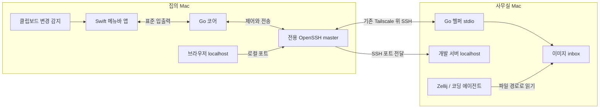

# 동작 설계

이 문서의 구성·CLI·설정은 제안입니다. 측정 실험 외 제품 기능은 아직 구현하지 않았습니다.

## 연결 구조



로컬 코어가 SSH 대상별 전용 master를 소유합니다. 원격 헬퍼는 같은 연결의 SSH exec 채널에서 `worklink remote --stdio`로 실행합니다. 별도 HTTP API·인바운드 서비스·클라우드 계정은 필요하지 않습니다. 초기 프로세스 구성은 로컬 앱·코어·SSH, 원격 헬퍼 및 기존 SSH 서버 세션입니다. 원격 이미지 정리만 하루 한 번 짧게 실행되는 사용자 LaunchAgent로 분리합니다.

Swift 앱과 로컬 코어, 로컬 코어와 원격 헬퍼의 메시지는 버전이 있는 길이 기반 프레임을 사용합니다. 메타데이터 JSON과 이미지 바이너리를 분리하고 작은 버퍼로 스트리밍합니다. 전체 이미지를 base64 JSON으로 여러 번 복사하지 않습니다. 프레임 길이·전송 크기·타임아웃을 수신 전에 제한합니다.

기존 `~/.ssh/config`는 읽어서 이용하되 덮어쓰지 않습니다. 전용 control socket은 사용자만 접근 가능한 짧은 경로에 둡니다. 프로세스 실행은 인자 배열을 사용하고 셸 문자열에 사용자 입력을 끼워 넣지 않습니다. 원격 실행 명령도 고정된 실행 파일과 인자로 제한합니다. 최초 호스트 키 확인은 사용자가 일반 SSH에서 완료하고, 앱은 batch 연결 실패를 명확히 표시합니다.

## 사용 흐름

1. 설치 시 사용할 SSH 별칭과 원격 헬퍼 위치를 지정합니다. 예: `office-mac`.
2. 개발 서버의 SSH 대상·원격 loopback 주소·포트·로컬 포트를 수동 등록하고, 메뉴바에서 업무 모드를 켭니다.
3. 등록된 개발 서버 주소를 집의 브라우저에서 엽니다. 서버 재시작 후에도 등록된 연결을 유지합니다.
4. 클립보드로 스크린샷을 캡처하면 이미지가 원격 inbox에 저장됩니다.
5. 전송 완료 후 원격 경로가 로컬 클립보드에 들어가면 에이전트 입력창에 붙여넣습니다. 이 흐름을 캡처마다 반복합니다. 그 사이 다른 내용을 복사했다면 경로 복사는 메뉴바/단축키로 요청할 수 있습니다.
6. 업무 모드를 끄면 감지·재연결·포트 전달을 종료합니다. Zellij 작업은 별개로 유지합니다.

“원격에 파일이 도착함”, “경로를 복사함”, “에이전트가 이미지를 입력받음”을 서로 다른 완료 상태로 표시합니다. 앱은 마지막 단계까지 완료됐다고 추정하지 않습니다.

## 이미지 전송

자동 전송은 사용자가 업무 모드에서 명시적으로 켠 경우에만 동작합니다. 일반 텍스트·비밀번호·파일 클립보드는 동기화하지 않습니다. 이미지 클립보드에도 민감한 정보가 있을 수 있으므로 현재 전송 대상과 일시 정지 상태를 메뉴바에서 보여줍니다. 업무 모드를 켤 때 이미 있던 클립보드는 보내지 않습니다.

사용자가 확정한 흐름은 **클립보드 캡처 → 원본 전송 1회 → 원격 경로 복사 → 에이전트 세션에 붙여넣기**입니다. 변경 번호 확인 → 이미지 타입 확인 → 안정된 원본 바이트 확보 → 크기 확인 → 전송 순서입니다. 추출 전후 변경 번호가 다르면 해당 스냅샷은 폐기합니다.

이미지의 추가 압축·리사이즈·화질 조정·자동 재인코딩은 하지 않습니다. PNG 표현이 있으면 그 바이트를 저장·전송하고, 다른 형식이면 원래 표현과 확장자를 유지합니다. 수신측 에이전트가 지원하지 않는 형식은 알리고 자동 변환하지 않습니다. SSH에도 `Compression=no`를 명시합니다. PNG 자체의 내부 형식을 바꾸는 처리도 하지 않습니다.

캡처 이벤트마다 UUID를 한 번 생성하고 같은 이벤트에는 작업을 다시 만들지 않습니다. 서로 다른 캡처가 같은 내용이어도 각각 처리합니다. 이미지 경로를 클립보드에 넣은 변화는 다음 이미지 전송을 발생시키지 않습니다. 네트워크 실패 시에는 같은 ID로 완료 여부를 확인하고 필요시 재시도하여 원격 파일이 중복 생성되지 않게 합니다. 정상 동작에서는 캡처당 업로드 1회이며 장애 시 네트워크 송신까지 반드시 한 번이라고 보장하지 않습니다.

전송 동시 작업은 1개입니다. 초기 용량 제한 후보는 이미지 1개 16 MiB, 대기 큐 8개·합계 64 MiB이며 설정에서 조정할 수 있습니다. 초과하면 알리고 원본 전송을 거부하며 용량을 맞추려고 화질을 줄이지 않습니다. 큐는 디스크에 두고 원격 저장 완료 ACK 후 로컬 임시 파일을 삭제합니다. 사용자가 캡처 기능으로 따로 저장한 원본 파일은 삭제하지 않습니다. 원본 추출 순간의 메모리는 별도로 측정합니다.

원격 저장 위치는 사용자 소유의 Worklink 전용 inbox입니다. 파일명은 `worklink-capture-20261005T103012.123Z-<UUID>.png`처럼 Worklink 접두어·수신측 UTC 생성 시각·캡처 ID·원본 형식 확장자를 포함합니다. 파일명은 수신측이 생성합니다. 임시 파일에 쓰고 SHA-256으로 원본 바이트를 검증한 뒤 atomic rename하여 확정합니다. 같은 ID의 재시도는 기존 결과를 반환합니다. 디렉터리는 0700, 파일은 0600이며 symlink를 따라 쓰지 않습니다.

완료 시 원격 경로를 클립보드에 넣는 동작을 기본으로 합니다. 전송 완료 시 원래 변경 번호와 일치할 때만 수행합니다. 전송 중 사용자가 다른 내용을 복사했다면 덮어쓰지 않고 전송 완료와 복사 가능한 경로를 표시합니다. 프로젝트·호스트를 전환하면 이전 전송 결과가 새 대상으로 섞이지 않도록 connection generation을 확인합니다.

연결 단절 시 큐의 이미지에는 생성 시점의 대상 호스트를 고정합니다. 업무 모드가 ON인 동안만 재시도하고 30분 지난 대기 항목은 만료 상태로 표시합니다. OFF·잠금·재시작 후 오래된 항목을 갑자기 전송하지 않으며 명시적으로 다시 보내도록 합니다.

원격에서 사용할 CLI 후보:

```sh
worklink image latest           # 현재 호스트의 마지막 완료 이미지 경로
worklink image list             # 시간, 크기, 경로
worklink image export <id> <destination>
```

멀티 프로젝트에서는 전송 시작 시 선택된 workspace ID를 메타데이터에 고정합니다. “latest”는 편의 기능이며 특정 작업에 참조할 때는 UUID가 포함된 실제 파일 경로를 사용합니다. 자동 입력·자동 프롬프트 실행은 하지 않습니다.

## 원격 이미지 정리

원격의 사용자 LaunchAgent가 하루 한 번 `worklink image cleanup`을 실행하고 종료합니다. 정리를 위해 별도 프로세스를 하루 종일 띄우지 않습니다. `StartCalendarInterval`로 일일 실행 시각을 지정하는 방식입니다. [Apple launchd 문서](https://developer.apple.com/library/archive/documentation/MacOSX/Conceptual/BPSystemStartup/Chapters/CreatingLaunchdJobs.html)

보관 기간의 기본 후보는 **최소 24시간**입니다. 하루 한 번 실행하므로 실제 자동 보관은 대략 24–48시간이 됩니다. 오늘 막 붙여넣은 파일을 당일 정리 시각에 지우지 않습니다. 원격 inbox 안에서 정확한 파일명 형식과 관리 기록이 일치하는 완료 파일만 정리하고, 업로드 중 파일·보관 표시 파일·다른 파일은 제외합니다. mtime 대신 파일명에 기록한 수신측 생성 시각을 사용합니다.

접속하지 않은 날에도 원격 사용자가 로그인한 동안 일일 작업을 실행할 수 있습니다. 로그아웃·전원 꺼짐 등으로 실행하지 못한 경우 다음 연결 시 마지막 성공 시각을 확인하고 누락된 정리 1회를 수행합니다. 동시 정리는 잠금으로 막고, 긴급 용량 부족 시에는 새 전송을 거부하여 알립니다. 원격 512 MiB 상한 후보는 설정에서 조정하며, 상한을 이유로 최소 보관 기간을 무시하고 즉시 삭제하지 않습니다. 장기 참조할 이미지는 보관 표시하거나 프로젝트로 내보냅니다.

현재는 정리 정책만 설계했습니다. LaunchAgent 설치나 실제 파일 삭제는 수행하지 않았습니다.

## 수동 등록한 개발 서버 연결

사용자가 등록한 endpoint만 관리합니다. 여기서 등록 대상은 호스트 이름만이 아니라 **SSH 별칭 + 원격 loopback 주소 + 원격 포트 + 로컬 포트** 조합입니다. 예를 들어 `office-mac / 127.0.0.1:5173 → 로컬 127.0.0.1:5173`입니다. 이름·활성 여부도 저장하고 항목을 하나씩 추가·중지·삭제할 수 있습니다. 서버 실행 명령은 바꿀 필요가 없습니다. 초기 로컬/원격 포트 범위는 1024–65535, 등록 수 후보는 16개입니다.

```sh
worklink port add --host office-mac --remote-port 5173 --local-port 5173 --name frontend
worklink port add --host office-mac --remote-port 4387 --local-port 14387 --name preview
worklink port list
worklink port remove preview
```

아직 실행할 수 없는 CLI 설계 예시입니다. 기본 원격 주소는 `127.0.0.1`이고 `::1`을 명시적으로 지정할 수도 있습니다. SSH 대상별 연결을 재사용하고 활성화된 등록 항목의 터널을 유지하므로 서버가 꺼졌다 켜져도 매번 터널을 새로 등록할 필요가 없습니다.

감시는 등록된 원격 주소·포트의 TCP 연결 가능 여부만 확인합니다. 업무 ON·연결 READY일 때 원격 헬퍼 내부의 단일 스케줄러로 5초 간격 확인을 초기 후보로 두고, 짧은 타임아웃·최대 동시 확인 2개를 적용합니다. 확인 직후 연결을 닫고 HTTP 요청이나 인증 정보를 보내지 않습니다. 전체 프로세스/리스너 열거와 매번 외부 명령 실행은 하지 않습니다. 작업 OFF·절전·SSH 단절에서는 이 확인도 중지합니다. 기존 `lsof` 측정치는 이 감시 방식의 성능 수치로 재사용하지 않습니다.

SSH는 `-L 127.0.0.1:<local>:127.0.0.1:<remote>` 형태로 바인딩합니다. IPv6 localhost 주소도 사용하려면 `::1` 리스너를 함께 관리하고 부분 성공을 확인합니다. 원격 서버가 `::1`에만 열려 있으면 등록된 목적지 주소를 사용합니다. 임의 외부 주소로의 포워딩은 기본 기능에 넣지 않습니다.

로컬 포트 충돌 시 기존 프로세스를 종료하지 않습니다. 사용 가능한 대체 포트를 안내하고 사용자가 고른 주소를 저장합니다. 대체 포트가 OAuth 콜백이나 HMR 설정에 영향을 주면 같은 포트를 비운 후 재연결하는 경로를 제공합니다.

`ExitOnForwardFailure`는 포워딩 리스너 생성 실패를 확인하는 수단이며 원격 앱의 응답까지 보장하지 않습니다. 터널 상태·원격 포트 연결 가능 상태·실제 HTTP 응답을 구분합니다. TCP 확인은 서비스 종류를 판별하지 않으며, HTTP 확인은 사용자가 브라우저를 열 때 필요에 따라 수행합니다.

Spotify 같은 일반 앱은 등록하지 않으면 감시·전달 대상이 아닙니다. 다만 등록한 바로 그 주소·포트를 나중에 다른 앱이 사용하면 TCP 감지만으로 구분할 수 없습니다. 따라서 등록 UI에 주소와 용도를 표시하고 사용하지 않는 항목을 중지할 수 있게 합니다. 프로젝트/PID 확인을 통한 자동 분류는 현재 범위에서 제외합니다. 미등록 포트는 자동으로 추가하지 않으며 전체 리스너 자동 발견과 실행 wrapper도 초기 제품에 포함하지 않습니다.

## 상태와 종료

| 상태 | 동작 |
| --- | --- |
| OFF | 정기 감지·연결·재시도 없음, 메뉴바만 유지 |
| CONNECTING | 타임아웃이 있는 연결 1개만 실행 |
| READY | 클립보드 변경 번호 확인, 등록된 터널 유지 |
| BACKOFF | 지수 backoff + jitter, 큐 크기 제한 |
| BLOCKED | 인증·호스트 키·권한 오류를 표시, 자동 반복하지 않음 |
| SUSPENDED | 화면 잠금·절전 중 이미지 감지와 전송 중지 |

복귀 시 새 연결 generation을 생성하고 등록된 터널을 재구성합니다. 절전 직전 이미지를 중복 전송하지 않도록 원격 ACK와 ID를 대조합니다. UI가 종료하면 코어·전용 master도 종료하고 EOF로 원격 헬퍼가 끝나게 합니다. 비정상 종료에 대비해 PID만 믿지 말고 control socket 소유권과 세션 ID를 확인합니다. 원격 헬퍼는 별도 LaunchAgent 없이도 끊어진 세션을 감지하도록 idle lease/SSH keepalive를 검증합니다.

이미지 추출·전송·SSH 명령이 영구 대기하지 않도록 단계별 타임아웃과 취소를 둡니다. 기존 사용자의 SSH master·다른 터널·Zellij 세션은 종료 대상이 아닙니다.

## 선택적 스크린샷 폴더 모드

클립보드 권한이나 기존 클립보드 도구와 충돌하면 전용 폴더의 새 이미지 파일을 관찰합니다. FSEvents는 파일 시스템 변경을 묶어서 통지하므로 전체 폴더를 매초 열거하는 것보다 적합합니다. 시작 시 watcher를 먼저 설치하고 스냅샷을 읽으며, 이벤트 누락·합쳐짐을 감안해 해당 폴더를 재검사합니다. 초기 파일은 자동 전송하지 않고 새로 생성된 파일만 처리합니다. [Apple FSEvents](https://developer.apple.com/documentation/coreservices/file_system_events)

전체 Desktop이나 사용자 홈을 감시하지 않습니다. 앱이 OS의 기본 스크린샷 저장 위치를 자동으로 바꾸지도 않습니다. 파일 작성 완료와 symlink·크기 제한을 확인하고 중복 전송을 막습니다.
