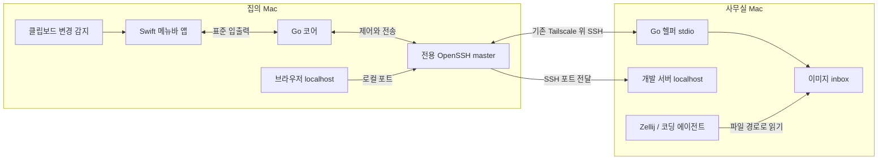

# 동작 설계

이 문서의 구성·CLI·설정은 제안입니다. 측정 실험 외 제품 기능은 아직 구현하지 않았습니다.

## 연결 구조



로컬 코어가 전용 SSH master를 소유합니다. 원격 헬퍼는 같은 연결의 SSH exec 채널에서 `worklink remote --stdio`로 실행합니다. 별도 HTTP API·인바운드 서비스·클라우드 계정은 필요하지 않습니다. 초기 프로세스 구성은 로컬 앱·코어·SSH, 원격 헬퍼 및 기존 SSH 서버 세션입니다.

Swift 앱과 로컬 코어, 로컬 코어와 원격 헬퍼의 메시지는 버전이 있는 길이 기반 프레임을 사용합니다. 메타데이터 JSON과 이미지 바이너리를 분리하고 작은 버퍼로 스트리밍합니다. 전체 이미지를 base64 JSON으로 여러 번 복사하지 않습니다. 프레임 길이·전송 크기·타임아웃을 수신 전에 제한합니다.

기존 `~/.ssh/config`는 읽어서 이용하되 덮어쓰지 않습니다. 전용 control socket은 사용자만 접근 가능한 짧은 경로에 둡니다. 프로세스 실행은 인자 배열을 사용하고 셸 문자열에 사용자 입력을 끼워 넣지 않습니다. 원격 실행 명령도 고정된 실행 파일과 인자로 제한합니다. 최초 호스트 키 확인은 사용자가 일반 SSH에서 완료하고, 앱은 batch 연결 실패를 명확히 표시합니다.

## 사용 흐름

1. 설치 시 사용할 SSH 별칭과 원격 헬퍼 위치를 지정합니다. 예: `office-mac`.
2. 메뉴바에서 업무 모드를 켭니다. 이미지 자동 전송 옵션과 포트 프로필을 선택합니다.
3. 등록된 개발 서버 주소를 집의 브라우저에서 엽니다. 서버 재시작 후에도 등록된 연결을 유지합니다.
4. 클립보드로 스크린샷을 캡처하면 이미지가 원격 inbox에 저장됩니다.
5. 전송 완료 후 메뉴바/단축키로 원격 경로를 복사해 에이전트 입력창에 붙여넣습니다. 원격 CLI에서 최신 경로를 조회하는 방법도 제공합니다.
6. 업무 모드를 끄면 감지·재연결·포트 전달을 종료합니다. Zellij 작업은 별개로 유지합니다.

“원격에 파일이 도착함”, “경로를 복사함”, “에이전트가 이미지를 입력받음”을 서로 다른 완료 상태로 표시합니다. 앱은 마지막 단계까지 완료됐다고 추정하지 않습니다.

## 이미지 전송

자동 전송은 사용자가 업무 모드에서 명시적으로 켠 경우에만 동작합니다. 일반 텍스트·비밀번호·파일 클립보드는 동기화하지 않습니다. 이미지 클립보드에도 민감한 정보가 있을 수 있으므로 현재 전송 대상과 일시 정지 상태를 메뉴바에서 보여줍니다. 업무 모드를 켤 때 이미 있던 클립보드는 보내지 않습니다.

변경 번호 확인 → 이미지 타입 확인 → 안정된 스냅샷 확보 → 크기 제한 → 필요시 PNG 변환 → 해시 확인 → 전송 순서입니다. 추출 전후 변경 번호가 다르면 해당 스냅샷은 폐기합니다. PNG 표현이 이미 있으면 가능한 한 재인코딩하지 않습니다. TIFF 등은 픽셀 수를 확인한 뒤 변환합니다. PNG를 SSH에서 다시 압축하는 것은 기본으로 사용하지 않습니다.

초기 제한은 이미지 1개 16 MiB, 16 megapixel, 변환·전송 동시 작업 1개입니다. 작은 이미지라도 해상도가 지나치게 크면 변환 전에 거부합니다. 큐는 8개 및 총 64 MiB로 제한하고 디스크에 둡니다. 초과 시 새 작업을 거부하고 실패 항목을 보여줍니다. 조용히 기존 이미지를 삭제하지 않습니다. 읽기·변환 순간의 메모리는 별도로 측정합니다.

원격 저장 위치는 사용자 소유의 Worklink 전용 inbox입니다. 파일명은 수신측이 생성하고 UUID와 내용 해시로 재시도 중복을 막습니다. 임시 파일에 제한된 크기로 쓰고 SHA-256 검증 후 atomic rename하여 확정합니다. 같은 ID의 재시도는 기존 결과를 반환합니다. 송신자가 임의 원격 경로를 지정하지 못하게 합니다. 디렉터리는 0700, 파일은 0600이며 symlink를 따라 쓰지 않습니다.

원격 inbox의 기본 보관 후보는 7일·512 MiB이며, 사용자가 보관 표시한 파일은 자동 정리에서 제외합니다. 보관 파일로 한도가 찼다면 새 전송을 거부합니다. 장기 문서에 쓰는 이미지는 프로젝트로 명시적으로 내보내야 합니다. 자동 정리는 Worklink가 생성한 파일만 대상으로 합니다.

원본 이미지 클립보드는 기본으로 보존합니다. 선택적 “완료 시 경로로 바꾸기”는 전송 완료 시 원래 변경 번호와 일치할 때만 수행합니다. 전송 중 사용자가 다른 내용을 복사했다면 덮어쓰지 않습니다. 자기 자신이 복사한 경로는 이미지 전송 대상으로 취급하지 않습니다. 프로젝트·호스트를 전환하면 이전 전송 결과가 새 대상으로 섞이지 않도록 connection generation을 확인합니다.

연결 단절 시 큐의 이미지에는 생성 시점의 대상 호스트를 고정합니다. 업무 모드가 ON인 동안만 재시도하고 30분 지난 대기 항목은 만료 상태로 표시합니다. OFF·잠금·재시작 후 오래된 항목을 갑자기 전송하지 않으며 명시적으로 다시 보내도록 합니다.

원격에서 사용할 CLI 후보:

```sh
worklink image latest           # 현재 호스트의 마지막 완료 이미지 경로
worklink image list             # 시간, 크기, 경로
worklink image export <id> <destination>
```

멀티 프로젝트에서는 전송 시작 시 선택된 workspace ID를 메타데이터에 고정합니다. “latest”는 편의 기능이며 특정 작업에 참조할 때는 UUID가 포함된 실제 파일 경로를 사용합니다. 자동 입력·자동 프롬프트 실행은 하지 않습니다.

## 포트 연결

기본 프로필과 명시적 등록을 먼저 지원합니다. 프로젝트별 등록은 원격 헬퍼의 사용자 전용 Unix socket에 알리고 헬퍼가 로컬로 변경 이벤트를 보냅니다. 앱이 서버 프로세스를 관리하는 wrapper 모드에서는 자식 프로세스 종료도 이벤트로 보낼 수 있습니다. 포트 번호는 1024–65535, 한 프로필의 초기 등록 수는 최대 16개입니다.

```sh
worklink run --port 5173 -- npm run dev
worklink port add 4387
worklink port list
worklink port remove 4387
```

SSH는 `-L 127.0.0.1:<local>:127.0.0.1:<remote>` 형태로 바인딩합니다. IPv6 localhost 주소도 사용하려면 `::1` 리스너를 함께 관리하고 부분 성공을 확인합니다. 원격 서버가 `::1`에만 열려 있으면 등록된 목적지 주소를 사용합니다. 임의 외부 주소로의 포워딩은 기본 기능에 넣지 않습니다.

로컬 포트 충돌 시 기존 프로세스를 종료하지 않습니다. 사용 가능한 대체 포트를 안내하고 사용자가 고른 주소를 저장합니다. 대체 포트가 OAuth 콜백이나 HMR 설정에 영향을 주면 같은 포트를 비운 후 재연결하는 경로를 제공합니다.

`ExitOnForwardFailure`는 포워딩 리스너 생성 실패를 확인하는 수단이며 원격 앱의 응답까지 보장하지 않습니다. 연결 상태와 개발 서버 응답 상태를 구분합니다. 브라우저를 열 때 요청 기반으로 확인하고 매초 HTTP health check를 보내지 않습니다.

wrapper 사용이 강제되면 기존 에이전트 흐름과 충돌할 수 있습니다. 따라서 임의 서버의 자동 발견은 후속 opt-in 모드로 유지합니다. 자동 발견에는 동일 사용자·허용된 포트/프로젝트 규칙·삭제 grace period가 필요합니다. 포트 번호만 같아도 다른 서비스로 바뀔 수 있어 후보의 PID·프로세스 시작 시점·규칙을 재확인해야 합니다.

## 상태와 종료

| 상태 | 동작 |
| --- | --- |
| OFF | 정기 감지·연결·재시도 없음, 메뉴바만 유지 |
| CONNECTING | 타임아웃이 있는 연결 1개만 실행 |
| READY | 클립보드 변경 번호 확인, 등록된 터널 유지 |
| BACKOFF | 지수 backoff + jitter, 큐 크기 제한 |
| BLOCKED | 인증·호스트 키·권한 오류를 표시, 자동 반복하지 않음 |
| SUSPENDED | 화면 잠금·절전 중 이미지 감지와 전송 중지 |

복귀 시 새 연결 generation을 생성하고 등록된 터널을 재구성합니다. 절전 직전 이미지를 중복 전송하지 않도록 원격 ACK와 ID를 대조합니다. UI가 종료하면 코어·전용 master도 종료하고 EOF로 원격 헬퍼가 끝나게 합니다. 비정상 종료에 대비해 PID만 믿지 말고 control socket 소유권과 세션 ID를 확인합니다. 원격 헬퍼는 별도 LaunchAgent 없이도 끊어진 세션을 감지하도록 idle lease/SSH keepalive를 검증합니다.

이미지 전송·Swift 변환·SSH 명령이 영구 대기하지 않도록 단계별 타임아웃과 취소를 둡니다. 기존 사용자의 SSH master·다른 터널·Zellij 세션은 종료 대상이 아닙니다.

## 선택적 스크린샷 폴더 모드

클립보드 권한이나 기존 클립보드 도구와 충돌하면 전용 폴더의 새 이미지 파일을 관찰합니다. FSEvents는 파일 시스템 변경을 묶어서 통지하므로 전체 폴더를 매초 열거하는 것보다 적합합니다. 시작 시 watcher를 먼저 설치하고 스냅샷을 읽으며, 이벤트 누락·합쳐짐을 감안해 해당 폴더를 재검사합니다. 초기 파일은 자동 전송하지 않고 새로 생성된 파일만 처리합니다. [Apple FSEvents](https://developer.apple.com/documentation/coreservices/file_system_events)

전체 Desktop이나 사용자 홈을 감시하지 않습니다. 앱이 OS의 기본 스크린샷 저장 위치를 자동으로 바꾸지도 않습니다. 파일 작성 완료와 symlink·크기 제한을 확인하고 중복 전송을 막습니다.
